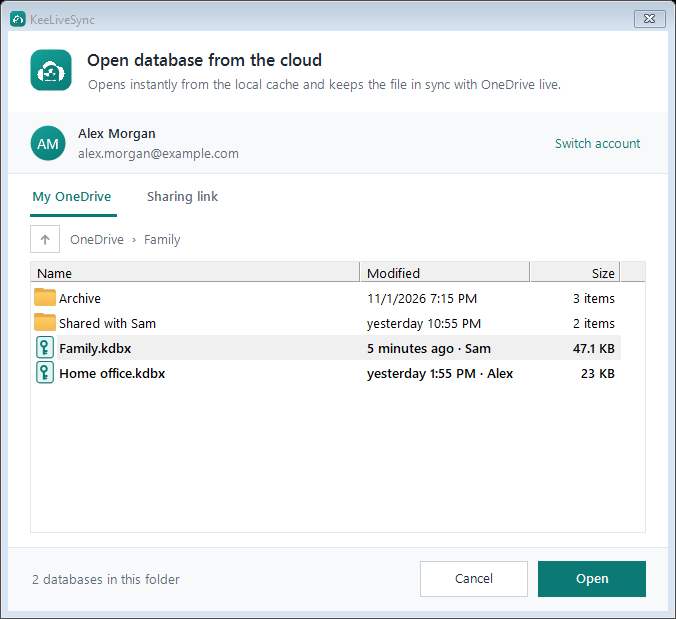
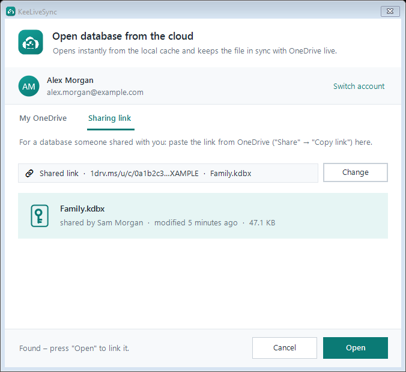
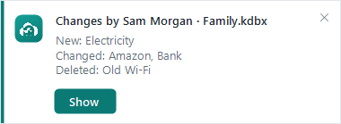
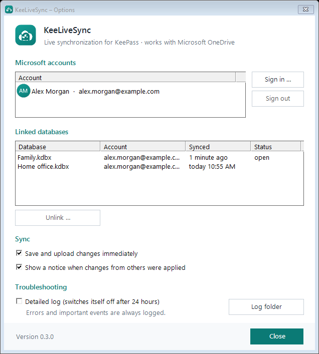

# KeeLiveSync

**Live synchronization of KeePass 2 databases – works with Microsoft OneDrive.**

KeeLiveSync is a plugin for [KeePass Password Safe 2](https://keepass.info). It opens a database
stored in OneDrive instantly from a local copy, keeps it in sync in the background and merges changes
made by other people or devices – while the database stays open, without reloading and without losing
your place in the entry list.

It was built for a database that two people share (a household or a small team), each with their own
PC and a phone app such as KeePassium.

> 🇩🇪 Eine deutsche Kurzbeschreibung steht [weiter unten](#deutsch).

## Screenshots

| Open from OneDrive | Open a shared database |
| --- | --- |
|  |  |

| Changes from others | Status bar | Options |
| --- | --- | --- |
|  |  |  |

<sub>Example data. Screenshots are generated with `tools/screenshots.ps1`.</sub>

## Features

- **Opens instantly.** The database is opened from a local cache; the cloud is checked afterwards.
- **Push instead of polling.** Changes in OneDrive are reported by Microsoft Graph via a live
  connection (socket.io). Typical delay: about 30 seconds. No timers, no periodic downloads.
- **Real merging.** Remote changes are merged with KeePass' own synchronization
  (`PwDatabase.MergeIn`) – new, changed, moved and deleted entries, including history.
- **Quiet UI updates.** Only the affected rows of the entry list are inserted, removed or refreshed.
  The window does not grey out, the scroll position and selection are kept.
- **Safe uploads.** Every upload carries the version it is based on (`If-Match`). If someone else saved
  in the meantime, OneDrive rejects the upload (412), KeeLiveSync merges and uploads again – no
  conflict copies, no lost changes.
- **Heals overwrites.** If another app overwrote the file without merging (e.g. "Overwrite" in a mobile
  app), KeeLiveSync also merges the skipped versions from the OneDrive version history and restores
  what was lost.
- **Save and upload immediately** (optional, on by default): changes are saved and uploaded about one
  second after you press OK – also when you close KeePass right away.
- **Waits for open dialogs.** While you edit an entry, incoming changes are held back and merged as
  soon as the dialog is closed.
- **Shared databases.** Open a database someone shared with you by pasting the OneDrive sharing link
  (file or folder). No need to add it to "My files".
- **Several databases and accounts** at the same time, each in its own KeePass tab.
- **Status at a glance.** A small indicator in the status bar ("Live · in sync") with details in its
  tooltip.
- **Know what changed – and who changed it.** One notice per sync lists the entries by title
  ("New: Bank/Checking account", "Changed: Amazon", "Deleted: Old Wi-Fi") and the Microsoft account that
  saved them. "Show" lists exactly these entries across all groups, like search results. Notices stack,
  pause while the mouse is over them, and are collected while KeePass is minimized or in the tray.
  "Recent changes" in the status bar menu shows the last 20 syncs again (kept in memory only).
- **Sign-in reminder.** If the Microsoft sign-in has expired, a notice offers to sign in again; until
  then you keep working with the local copy.
- **Clean diagnostics.** Errors and events are always logged; a detailed log can be switched on in the
  options and switches itself off after 24 hours. Logs never contain passwords, tokens or database
  contents.
- **KeePass triggers and other plugins keep working.** The quiet save raises the same
  "saving/saved database file" triggers and plugin events as a normal save.
- **Languages:** English, German, French, Spanish, Italian, Dutch and Polish, following the KeePass
  language (see [Translations](#translations)).

## Requirements

- KeePass 2.x on Windows (developed and tested with **KeePass 2.61.1**), .NET Framework 4.8
- A Microsoft account with OneDrive
  - Tested with personal Microsoft accounts and with a Microsoft 365 work account (OneDrive for
    Business). For work accounts, an administrator may have to approve the app once.

## Installation

1. Download `KeeLiveSync.dll` from the [latest release](https://github.com/KeeLiveSync/KeeLiveSync/releases/latest).
2. Copy it into the `Plugins` folder of your KeePass installation
   (e.g. `C:\Program Files\KeePass Password Safe 2\Plugins`).
3. Restart KeePass.

KeePass checks for new versions of KeeLiveSync together with its own update check.

### Verifying a download

Releases are built by GitHub Actions and published only after `SHA256SUMS.txt` has been signed offline
with the KeeLiveSync release key (`SHA256SUMS.txt.sig`, RSA/SHA-256). The public key is in
[`src/KeeLiveSync/ReleaseKey.cs`](src/KeeLiveSync/ReleaseKey.cs) (fingerprint `6A35F060C245973F`).
The update information `version.txt` is signed with the same key, and KeeLiveSync tells KeePass to
reject it if the signature does not match.

## Usage

1. **File → Open → Open from the cloud (KeeLiveSync) …**
2. **Sign in with Microsoft** (a browser window opens; you only do this once per account).
3. Pick the database in **My OneDrive**, or paste a sharing link in the **Shared link** tab.
4. Enter the master key as usual.

From then on the database is linked: open it again via KeePass' recent files list or the same dialog.
Options are under **Tools → KeeLiveSync → Options** or by clicking the status indicator.

### Tips for mobile apps

Phone apps write the file directly to OneDrive. If an app asks what to do because the file has
changed, choose **Merge** where offered. If it overwrites anyway, KeeLiveSync restores the lost changes
from the version history the next time a PC with the plugin is online (up to 10 skipped versions).

### Personal and shared databases together

A common setup: everyone has a personal database, and a team or family database is shared. Open both
with KeeLiveSync – each in its own tab, from the same or different Microsoft accounts. To unlock only
once, use the [KeeAutoExec](https://keepass.info/plugins.html#keeautoexec) plugin by Dominik Reichl:
create a group `AutoOpen` in your personal database with an entry for the shared one –
**URL:** the local copy, e.g. `%APPDATA%\KeeLiveSync\cache\…\shared.kdbx` (the full path is listed under File → Open Recent),
**Password:** its master password, **User name:** the path of its key file (if any). When you unlock
your personal database, the shared one opens automatically and KeeLiveSync keeps it in sync.

## How it works

```
 KeePass ── opens ──▶ local cache (%APPDATA%\KeeLiveSync\cache)
    ▲                      │  save → upload with If-Match (cTag)
    │ merge (MergeIn)       ▼
    └──── download ◀── OneDrive file ◀── other PCs / phones
               ▲
               └── push notification (Microsoft Graph, socket.io)
```

- Data folder: `%APPDATA%\KeeLiveSync` (accounts, linked databases, cache, logs).
- Sign-in: OAuth 2.0 authorization code flow with PKCE via the system browser (public client, no
  secret). The refresh token is stored encrypted with Windows DPAPI for the current user.
- Permissions requested: `Files.ReadWrite.All` (read and write your own and shared files),
  `User.Read` (name and e-mail for the account list), `offline_access` (stay signed in).
- The push subscription covers the whole OneDrive drive (this is how Graph offers socket.io
  notifications). A notification only triggers a lightweight version check; the file is downloaded
  only when it has actually changed.

### About KeePass internals

Most of KeeLiveSync uses the official KeePass plugin API and KeePassLib. Three things have no public
API and are accessed via reflection, each with a safe fallback:

| What | Fallback if a future KeePass version changes it |
| --- | --- |
| Inserting/removing single rows in the entry list | full list refresh (correct, just less smooth) |
| Raising `FileSaving`/`FileSaved` for other plugins | other plugins are not notified of the quiet save |
| Looking up the trigger event IDs | triggers are not raised for the quiet save |

## Translations

English and German are written directly in the code. All other languages are JSON files in
[`src/KeeLiveSync/Languages`](src/KeeLiveSync/Languages) that map the English text to the translation
and are embedded in the DLL. French, Spanish, Italian, Dutch and Polish are machine translations by the
authors – **corrections are very welcome** as a pull request that changes only the JSON file.

- New language: create `<ISO 639-1 code>.json` (e.g. `pt.json`) with `{"_language": "Português"}` and run
  `python tools/i18n.py update` to add all texts; then translate.
- `{0}`, `{1}` … are placeholders and must stay in the translation.
- Plural forms: Polish uses an extra key `"<English plural>#few"` for 2–4, 22–24 …
- `python tools/i18n.py check` reports missing texts and wrong placeholders; the release build runs it too.

## Building

```
dotnet build src\KeeLiveSync -c Release -p:KeePassDir="C:\Program Files\KeePass Password Safe 2"
```

`KeePassDir` must contain `KeePass.exe`. If it has a `Plugins` folder, the built DLL is copied there.
The `poc` folder contains the command-line tools used to verify the Graph behavior (If-Match, push,
version history) and to create and modify test databases (password `test`, no real data).

## Privacy

KeeLiveSync talks only to Microsoft (sign-in and Microsoft Graph). It has no server of its own, sends
no telemetry and never transmits your master key – the database is encrypted before it leaves your PC,
exactly as KeePass saves it.

### Recommendation: protect cloud databases with more than a password

A database in the cloud can be copied by anyone who gets access to your Microsoft account or the shared
folder – and then attacked offline. Protect it with a **key file or a hardware key** in addition to the
master password:

- **Key file:** store it only locally on each device (not in OneDrive and not next to the database) and
  hand it over on a separate path, e.g. a USB stick. Without the key file, a copy of the database is
  useless even if the password is guessed.
- **Hardware key** (e.g. YubiKey) via a KeePass plugin, if all your devices and apps support it.
- In any case: a long, unique master password, and two-factor sign-in for the Microsoft account.

## License

[GNU General Public License v3.0](LICENSE) © 2026 Michael Kaufmann

KeePass is © Dominik Reichl and licensed under the GPL. Microsoft and OneDrive are trademarks of the
Microsoft group of companies. KeeLiveSync is an independent project and not affiliated with or endorsed
by Microsoft or the KeePass project.

---

## Deutsch

### Worum es geht

Eine KeePass-Datenbank, die zwei oder mehr Menschen gemeinsam nutzen – etwa im Haushalt oder in einem
kleinen Team –, liegt meist in OneDrive. Jeder hat sie am eigenen PC in KeePass offen, dazu auf dem Handy
in einer App wie KeePassium. Genau hier gehen im Alltag Einträge verloren:

- Zwei Geräte speichern kurz nacheinander. Das zweite überschreibt die Datei – der Eintrag vom ersten
  Gerät ist weg, oder es entsteht eine Konfliktkopie, die niemand bemerkt.
- Am PC ist die Datenbank stundenlang offen. Was jemand anderes inzwischen eingetragen hat, sieht man erst
  nach dem Schließen und erneuten Öffnen – und speichert man vorher selbst, überschreibt man es.
- Andere Plugins laden die Datei bei jedem Öffnen erst aus der Cloud (Wartezeit) und bemerken spätere
  Änderungen gar nicht.

**KeeLiveSync löst das:** Die Datenbank öffnet sofort, bleibt im Hintergrund auf dem neuesten Stand, und
Änderungen von allen Seiten werden zusammengeführt statt überschrieben.

### Was du davon hast

- **Sofort offen.** Die Datenbank öffnet aus einer lokalen Kopie ohne Wartezeit; den Abgleich mit der
  Cloud erledigt KeeLiveSync danach.
- **Live wie bei iCloud.** Legt jemand anderes am Handy oder PC einen Eintrag an, erscheint er bei dir
  nach etwa 30 Sekunden in der offenen Liste – ohne Neuladen, ohne Ausgrauen; Scrollposition und
  markierter Eintrag bleiben. Gelöschte Einträge verschwinden genauso. Eine dezente Einblendung sagt, wer
  was geändert hat.
- **Kein Speichern-Drücken nötig** (Option, standardmäßig an). Etwa eine Sekunde nach „OK“ ist die
  Änderung gespeichert und in der Cloud – auch wenn du KeePass direkt danach schließt.
- **Keine verlorenen Einträge bei gleichzeitigem Speichern.** Speichern zwei Geräte fast gleichzeitig,
  wird nichts überschrieben: Beide Änderungen landen in der Datenbank (Details unten).
- **Schutz vor dem Handy-„Überschreiben“.** Hat eine App die Datei ohne Zusammenführen überschrieben,
  holt KeeLiveSync den verlorenen Stand aus dem OneDrive-Versionsverlauf zurück.
- **Rücksicht beim Bearbeiten.** Während du einen Eintrag bearbeitest, wartet KeeLiveSync mit fremden
  Änderungen und führt sie erst nach dem Schließen des Dialogs zusammen.
- **Geteilte Datenbanken ohne Umweg.** Wer eine Datenbank freigegeben bekommen hat, fügt einfach den
  OneDrive-Freigabelink ein – „Zu meinen Dateien hinzufügen“ ist nicht nötig.
- **Alles im Blick.** Unten in der Statusleiste steht „Live · synchron“; der Tooltip zeigt den letzten
  Abgleich, wer zuletzt geändert hat und ob die Live-Verbindung steht. Läuft die Microsoft-Anmeldung ab,
  erscheint ein Hinweis mit „Jetzt anmelden“ – bis dahin arbeitest du mit der lokalen Kopie weiter.
- **Wer hat was geändert.** Eine Einblendung pro Abgleich nennt die Einträge mit Titel („Neu:
  Banken/Girokonto“, „Geändert: Amazon“, „Gelöscht: Altes WLAN“) und das Microsoft-Konto, das gespeichert
  hat. „Zeigen“ listet genau diese Einträge über alle Gruppen hinweg, wie ein Suchergebnis. Mehrere
  Einblendungen stapeln sich, bleiben stehen, solange die Maus darauf ist, und werden gesammelt, solange
  KeePass minimiert oder im Infobereich ist. „Letzte Änderungen“ im Menü der Statusanzeige zeigt die letzten
  20 Abgleiche erneut (nur im Speicher, nicht auf der Festplatte).
- **Sieben Sprachen.** Deutsch, Englisch, Französisch, Spanisch, Italienisch, Niederländisch und Polnisch –
  KeeLiveSync folgt automatisch der Sprache von KeePass. Verbesserungen an den Übersetzungen sind
  willkommen (siehe „Translations“ oben).

### So funktioniert es technisch

1. **Lokale Kopie zuerst.** Beim ersten Öffnen lädt KeeLiveSync die Datei einmal herunter und legt sie in
   `%APPDATA%\KeeLiveSync\cache` ab. KeePass arbeitet immer mit dieser Kopie – deshalb öffnet die
   Datenbank sofort und lässt sich auch offline nutzen.
2. **Versionskennung statt ganzer Dateien.** OneDrive vergibt für jeden Inhaltsstand eine Kennung (cTag).
   KeeLiveSync merkt sich, welchen Stand es zuletzt eingeführt hat. Nur wenn die Kennung in der Cloud
   abweicht, wird heruntergeladen.
3. **Push statt Zeitschaltuhr.** Über Microsoft Graph hält KeeLiveSync eine Live-Verbindung (socket.io)
   offen. Ändert sich etwas im OneDrive, meldet Microsoft das nach etwa 30 Sekunden. KeeLiveSync fragt
   dann kurz die Versionskennung ab (wenige hundert Byte) und lädt nur bei echter Änderung. Es gibt keinen
   Timer, der regelmäßig Dateien herunterlädt. Das Abonnement verlängert KeeLiveSync selbst.
4. **Zusammenführen mit KeePass' eigener Synchronisation.** Die Cloud-Fassung wird mit `PwDatabase.MergeIn`
   (Modus „Synchronisieren“) in die offene Datenbank eingeführt – derselbe Mechanismus wie
   „Datei → Synchronisieren“. Neue, geänderte, verschobene und gelöschte Einträge werden übernommen;
   ändern zwei Seiten denselben Eintrag, gewinnt die neuere Fassung, und die ältere landet im Verlauf des
   Eintrags. Gelöschtes bleibt gelöscht, weil KeePass Löschungen mit Zeitstempel vermerkt.
5. **Hochladen mit Versionsprüfung.** Beim Hochladen schickt KeeLiveSync mit, auf welchem Stand die
   Änderung beruht (`If-Match`). Hat inzwischen jemand anderes gespeichert, lehnt OneDrive das Hochladen
   ab (412). KeeLiveSync holt dann den neuen Stand, führt zusammen und lädt erneut hoch. So überschreibt
   ein Hochladen nie einen Stand, den es nicht kannte.
6. **Versionsverlauf gegen fremdes Überschreiben.** Apps ohne diese Prüfung können die Datei trotzdem
   überschreiben. Springt die Versionskennung dabei z. B. von 15 auf 17, holt KeeLiveSync Version 16 aus
   dem OneDrive-Versionsverlauf und führt sie zusätzlich ein (bis zu 10 übersprungene Versionen). Fehlt
   danach in der Cloud etwas, lädt KeeLiveSync den vollständigen Stand wieder hoch.
7. **Ruhige Anzeige.** Für die Liste nutzt KeeLiveSync interne KeePass-Funktionen, die einzelne Zeilen
   einfügen, entfernen oder auffrischen; gespeichert wird ohne die Sperre der Oberfläche. Ändert eine
   künftige KeePass-Version diese Funktionen, baut KeeLiveSync die Liste einfach vollständig neu auf.

### KeePassium und andere Handy-Apps

KeeLiveSync läuft auf dem PC; das Handy schreibt direkt in OneDrive. Das Zusammenspiel:

- **Am Handy geänderte Einträge** kommen per Push am PC an und werden eingeführt – ganz normal.
- **Fragt die App beim Speichern** „Datei wurde geändert – Überschreiben / Zusammenführen / Speichern
  unter“, ist **„Zusammenführen“** die beste Wahl, falls angeboten.
- **Wählt man doch „Überschreiben“** (oder überschreibt die App ohne Rückfrage), fehlen Einträge, die
  zwischendurch von einem anderen Gerät kamen, zunächst in der Cloud. Sobald ein PC mit KeeLiveSync die
  Änderung bemerkt, stellt er sie wieder her – aus seiner lokalen Kopie oder aus dem OneDrive-
  Versionsverlauf. Genau dieser Fall wurde getestet: KeePassium überschreibt einen Eintrag, der kurz
  vorher von einem anderen Gerät kam, und KeeLiveSync holt ihn automatisch zurück.

### Persönliche und gemeinsame Datenbank zusammen

Ein typischer Aufbau: Jeder hat eine eigene Datenbank, dazu gibt es eine gemeinsame für Familie oder Team.
Beide lassen sich mit KeeLiveSync öffnen – jede im eigenen Reiter, auch aus verschiedenen
Microsoft-Konten. Damit man nur einmal entsperren muss, hilft das Plugin
[KeeAutoExec](https://keepass.info/plugins.html#keeautoexec) von Dominik Reichl: In der eigenen Datenbank
eine Gruppe `AutoOpen` mit einem Eintrag für die gemeinsame anlegen – **URL:** die lokale Kopie, z. B.
`%APPDATA%\KeeLiveSync\cache\…\gemeinsam.kdbx` (den vollständigen Pfad zeigt Datei → Zuletzt geöffnet), **Passwort:** deren
Hauptpasswort, **Benutzername:** der Pfad ihrer Schlüsseldatei (falls vorhanden). Beim Entsperren der
eigenen Datenbank öffnet sich die gemeinsame automatisch, und KeeLiveSync hält sie synchron. Getestet mit
Passwort und Schlüsseldatei.

### Was KeeLiveSync zusichert – und wo die Grenzen sind

Zwischen PCs mit KeeLiveSync geht keine Änderung durch Überschreiben verloren: Jedes Hochladen ist an den
bekannten Stand gebunden, und alles wird zusammengeführt. Getestet sind gleichzeitiges Speichern
(412-Konflikt), Löschen, Bearbeiten während eines Abgleichs und Schließen mitten im Hochladen.

Die Grenzen, ehrlich benannt:

- Auf Handy-Apps hat KeeLiveSync keinen Einfluss. Was sie überschreiben, holt es aus dem Versionsverlauf
  zurück – solange OneDrive diese Version noch aufbewahrt, höchstens 10 Versionen übersprungen wurden und
  sobald ein PC mit KeeLiveSync läuft.
- Ist „Änderungen sofort speichern“ ausgeschaltet, liegen ungespeicherte Änderungen nur im offenen
  KeePass, bis du speicherst.
- KeeLiveSync ersetzt kein Backup deiner Datenbank.

### Sicherheit und Datenschutz

- Die Datenbank verlässt deinen PC nur verschlüsselt, genau so, wie KeePass sie speichert. Dein
  Hauptpasswort wird nie übertragen.
- KeeLiveSync spricht nur mit Microsoft (Anmeldung und Microsoft Graph). Es gibt keinen eigenen Server und
  keine Telemetrie.
- Die Anmeldung läuft über den Browser (OAuth mit PKCE, ohne Geheimnis im Programm). Das Anmelde-Token
  liegt mit Windows DPAPI verschlüsselt, lesbar nur für deinen Windows-Benutzer.
- Das Protokoll enthält nie Passwörter, Tokens oder Datenbankinhalte.
- Updates: Die Versionsdatei ist signiert, und Releases werden erst nach einer Offline-Signatur
  veröffentlicht (siehe „Verifying a download“ oben). KeeLiveSync lädt selbst nie Code nach.

**Empfehlung: Cloud-Datenbanken nicht nur mit einem Passwort schützen.** Eine Datenbank in der Cloud kann
jeder kopieren, der Zugriff auf dein Microsoft-Konto oder den freigegebenen Ordner bekommt – und dann in
Ruhe versuchen, das Passwort zu erraten. Sichere sie deshalb zusätzlich mit einer **Schlüsseldatei** oder
einem **Hardware-Schlüssel**:

- **Schlüsseldatei:** nur lokal auf jedem Gerät ablegen – nicht in OneDrive und nicht neben der Datenbank –
  und auf getrenntem Weg weitergeben, z. B. per USB-Stick. Ohne sie ist eine kopierte Datenbank wertlos,
  selbst wenn das Passwort bekannt wird.
- **Hardware-Schlüssel** (z. B. YubiKey) über ein KeePass-Plugin, sofern alle Geräte und Apps ihn
  unterstützen.
- In jedem Fall: ein langes, nur hier verwendetes Hauptpasswort und die Zwei-Faktor-Anmeldung für das
  Microsoft-Konto.

### Installation

1. `KeeLiveSync.dll` aus dem [neuesten Release](https://github.com/KeeLiveSync/KeeLiveSync/releases/latest)
   in den `Plugins`-Ordner von KeePass kopieren und KeePass neu starten.
2. **Datei → Öffnen → Aus der Cloud öffnen (KeeLiveSync) …**, mit Microsoft anmelden, Datenbank wählen
   (oder Freigabelink einfügen), Hauptschlüssel eingeben.
3. Ab dann öffnest du sie wie gewohnt über „Zuletzt geöffnet“. Einstellungen findest du unter
   **Extras → KeeLiveSync → Optionen** oder per Klick auf die Statusanzeige.
